# Token 统计（Token Audit Card）

> 常驻桌面的 Token 用量审计浮窗：统计 WorkBuddy / DSH 本地会话的 Token 消耗，实时跟踪商汤（SenseNova / 日日新）积分额度，并支持多台机器的数据导出与合并。

| 项 | 值 |
|---|---|
| **当前构建** | `v9.4-frost` |
| **平台** | Windows（已验证；PySide6 本身跨平台，但启动脚本为 Windows 批处理） |
| **运行时** | Python 3.13 · PySide6 6.11.1 |
| **第三方依赖** | **仅 PySide6**（扫描 / HTTP / JSON / 打包辅助全部标准库） |
| **数据来源** | 本机 `~/.workbuddy/projects/**/*.jsonl` + DSH 账本 + 商汤控制台接口 |
| **代码仓库** | <https://github.com/Suqianqiana/token-stats>（默认分支 `main`） |

---

## What's New in v9.4

**Frost & Settings** — build `v9.4-frost`

- **第二种材质：毛玻璃（Frost）。** 与液态玻璃并列、**互斥**，可与深浅色自由叠加。双层窗口架构：DWM 实时模糊挂在底层背板上，主窗口只画内容，面板外那圈露出真实桌面。
- **静态底纹模式。** 底纹是一张**糊好的图**（内置壁纸经**真高斯模糊** + 去饱和），运行时零抓屏、零延迟、拖拽响应跟手；也可自选任意图片，自动做同样处理。
- **毛玻璃下的视觉细化。** 内容卡片（模型明细 / 每日用量分布 / 活跃热力）在毛玻璃模式下补一层淡底与 1px 细描边，避免文字直接压在动态背景上；明细列表关闭斑马纹、改用细线分区；浮层（弹窗与主板）保持实体，否则会“隐形”在玻璃上。
- **设置页面（第95/97轮重做）。** 严格对齐设计稿：真·分段控件（与顶栏区间条同源）、桌宠主题 2×2 网格、底纹图片选择、开机自启 / 窗口置顶 / 尺寸切换，全部**即时生效并落盘记忆**。
- **每日用量分布重绘。** 堆叠柱改为**整根柱统一渐变**：暗色为「本色 → 本色混白 40%」（往下变淡、向白色渐隐），浅色为同色淡出；去掉早期立体光影，观感更清爽。
- **自定义来源用量不再丢失。** WorkBuddy 对自定义 provider（如本地 `127.0.0.1:8788/v1`）只落 `rawUsage`、折算后的 `usage` 全 0 —— 扫描器现在会回退解析原始响应，并归一化 `custom-local:` 前缀，用量统计不再缺一大块。
- **窗口置顶开关不再闪屏。** 改用 Win32 `SetWindowPos` 只改 Z 序（此前 `setWindowFlags` 会销毁重建原生窗口），且置顶态落盘、重启后恢复。
- **最小化到任务栏。** 右上角 `–` 现在真正缩到任务栏（此前误收进托盘）。
- **多项缺陷修复**：设置页刷新后顶部时间区间条异常复活、设置页卡片重复渲染、切换主题时卡片弹跳、设置页浅色模式文字不跟随、材质按钮切换逻辑失效（陈旧闭包）、悬浮球在关闭桌宠形态后无法拖动。
- **悬浮球拖动修复。** 关闭桌宠形态后，悬浮球原先无法拖动（`_moved` 标志位的置位条件误挂了 `self.pet`），且拖动松手会误弹统计面板；现已修正，两种形态均可正常拖动。
- **静态底纹可替换。** 内置底纹 `assets/frost_bg.png` 可由任意图片经同一处理链（真高斯 + 去饱和）重新生成，见 `tools/set_frost_bg.py`。

---

## 目录

- [一、项目简介](#一项目简介)
- [二、界面预览](#二界面预览)
- [三、功能详解](#三功能详解)
- [四、技术架构](#四技术架构)
- [五、数据与文件格式](#五数据与文件格式)
- [六、环境要求与安装](#六环境要求与安装)
- [七、启动与使用](#七启动与使用)
- [八、商汤积分自动同步配置](#八商汤积分自动同步配置)
- [九、打包与发布](#九打包与发布)
- [十、开发与调试](#十开发与调试)
- [十一、代码规范与视觉系统](#十一代码规范与视觉系统)
- [十二、GitHub 协作与跨机同步](#十二github-协作与跨机同步)
- [十三、目录结构](#十三目录结构)
- [十四、已知限制与注意事项](#十四已知限制与注意事项)

---

## 一、项目简介

「Token 统计」由两块组成：

- **悬浮球 / 桌宠**：常驻屏幕（置顶、可拖动、位置记忆），单击弹出统计卡片，右键打开菜单。
- **卡片窗口**：无边框圆角、双材质主题（液态玻璃 / 毛玻璃）、可拖动；左侧为数据源导航 + 设置，右侧为内容区。

四个数据源页签（侧栏导航，与「设置」并列）：

| 页签 | 内容 |
|---|---|
| **WorkBuddy** | 本机 WorkBuddy 会话的 Token 用量（按模型 / 按日） |
| **DSH 本地** | 本机 Deepseek-Harness-EAC 的用量与花费 |
| **商汤额度** | 商汤日日新积分池额度（滚动 5h / 滚动周），支持控制台接口自动同步 |
| **多机合并** | 多台机器的用量导出 / 导入 / 合并对比 |

设计取向：**本机数据始终实时扫描，不落快照**；别机数据以文件快照形式常驻本机，随时可覆盖或删除。整个过程无后端、无账号体系、不联网（商汤同步除外，且仅在你主动配置后启用）。

---

## 二、界面预览

> 截图由 `tools/shot_readme.py` 生成：隔离 HOME 到临时目录，灌入**合成匿名数据**（固定随机种子，可复现），再走**真实渲染链路**（扫描器扫合成 jsonl → 聚合 → 界面渲染），不含任何真实用量与账号信息。毛玻璃截图需在真实屏幕抓取（DWM 材质 offscreen 没有）。

### WorkBuddy 页 · 深色 + 毛玻璃

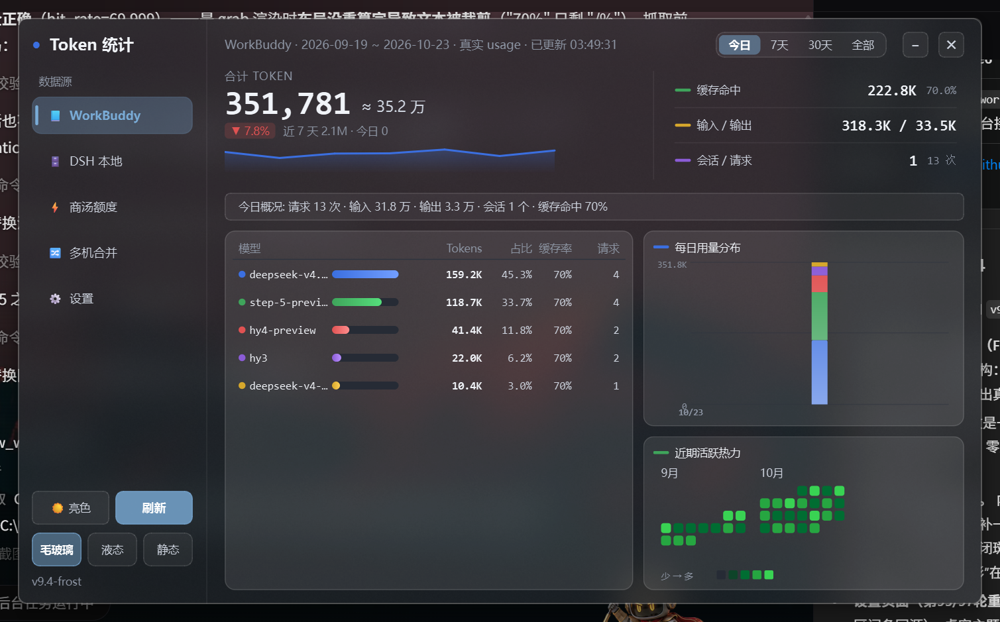

### DSH 本地页 · 深色 + 毛玻璃

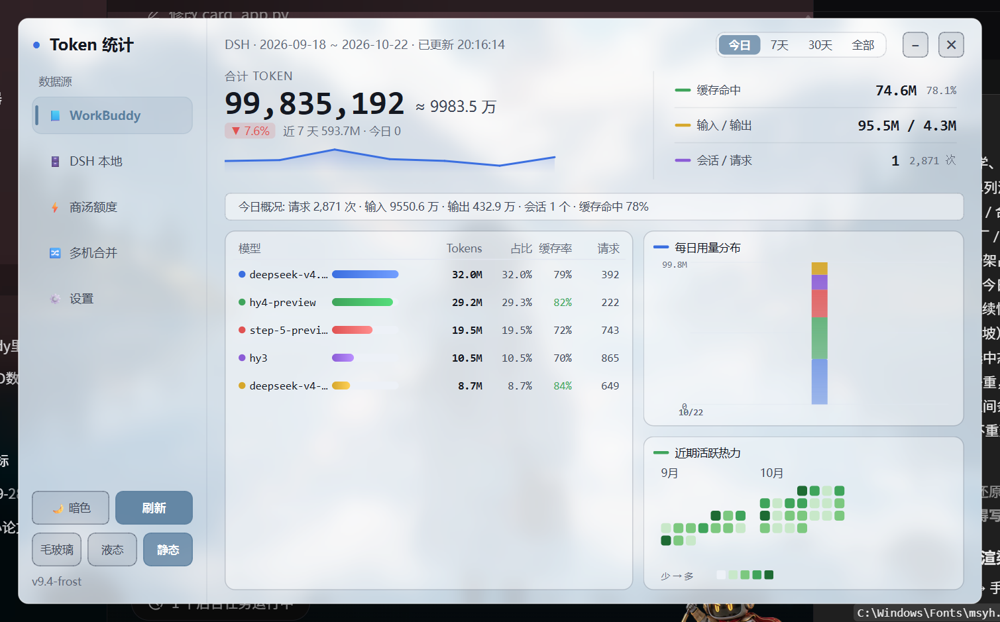

### 商汤额度页 · 深色 + 毛玻璃

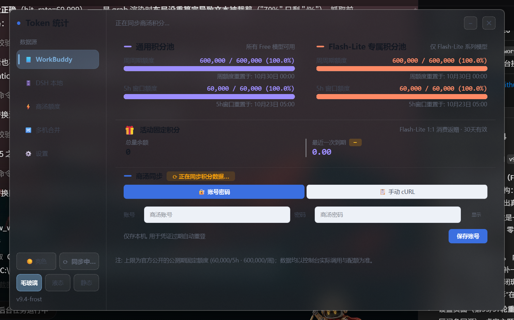

### 多机合并页 · 深色 + 毛玻璃

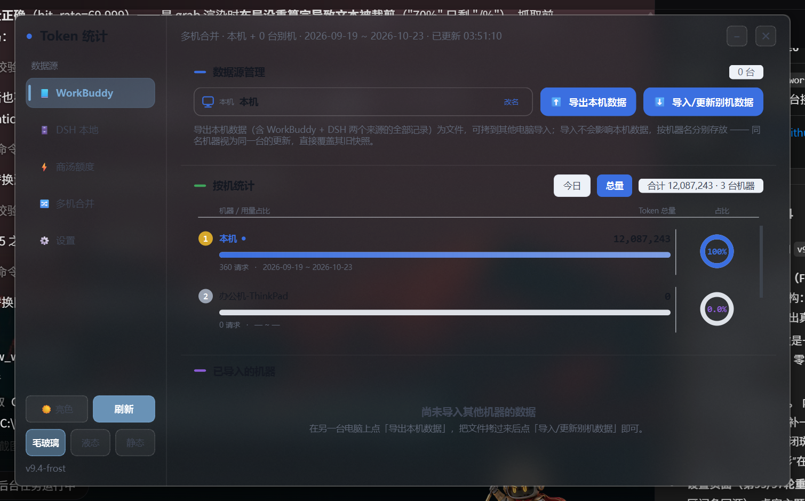

### 深色 + 液态玻璃

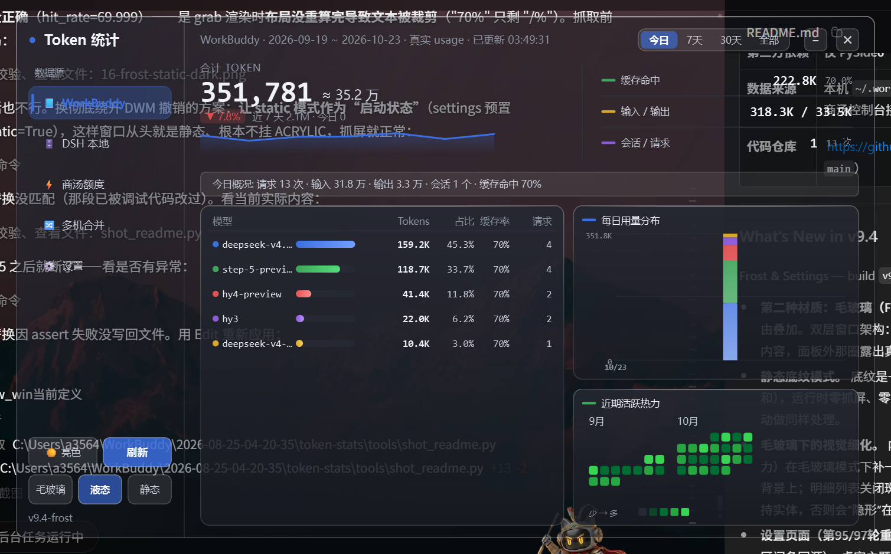

### 默认主题（无玻璃材质）· 深色

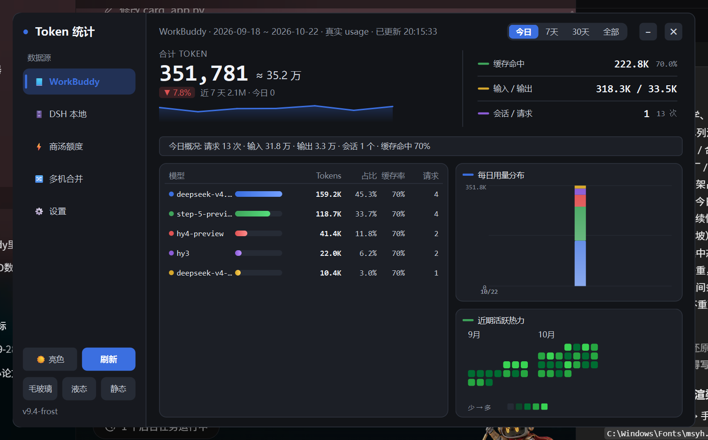

### 默认主题（无玻璃材质）· 浅色

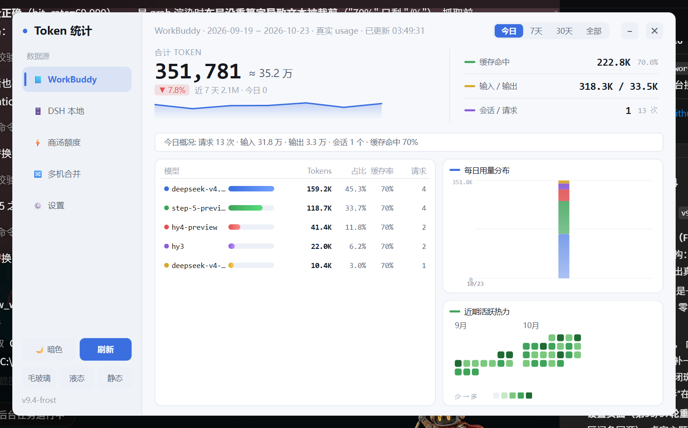

### 浅色 + 毛玻璃（奶白磨砂）

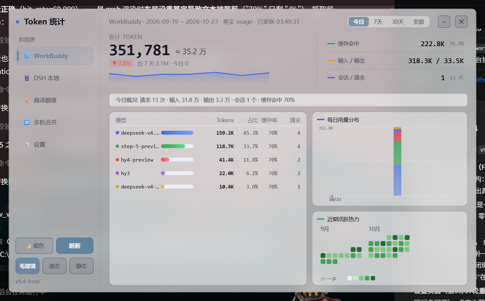

### 浅色 + 液态玻璃

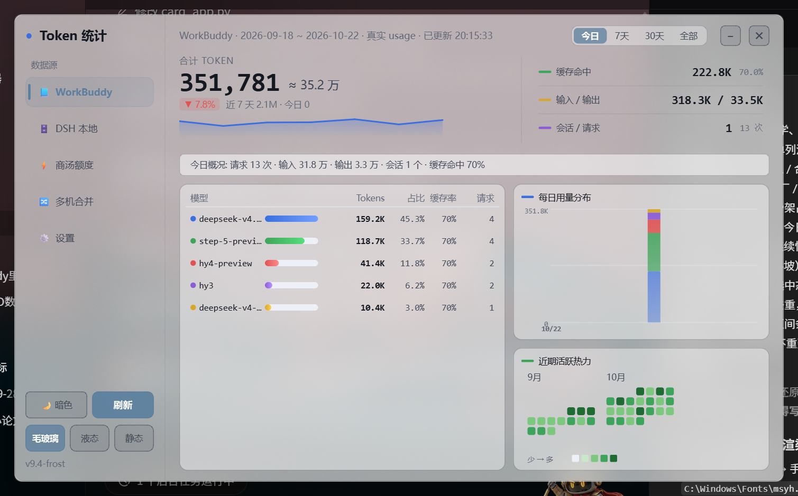

### 设置页面 · 深色

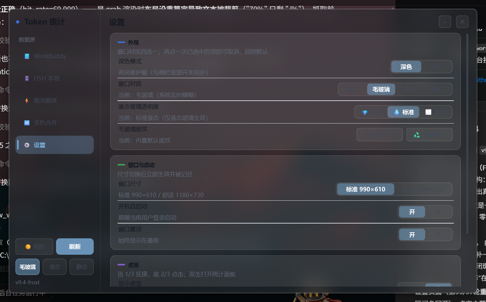

### 设置页面 · 浅色

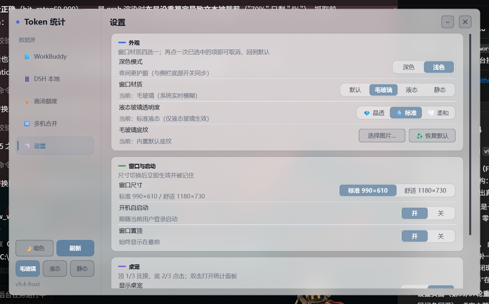

### 桌宠素材 · 三个主题的现役帧库

素材均为透明背景 PNG，绘制时按窗口预算等比缩放、底部对齐（帧高统一，播放不跳动）。
V3 / V4 为**全帧展示**，V5 为每场景抽样 8 帧的概览。

**V5 · 鲸鱼少女（`pet_v5`，149 帧：idle15 / click33 / sleep22 / wake15 / drag6 / sidle48 / pat10）**

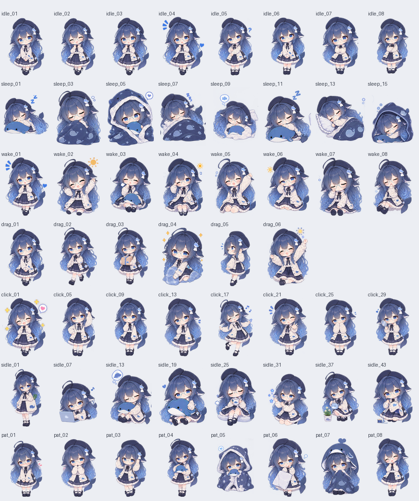

**V4 · deepseek娘V4Pro（`pet_v4`，12 帧：idle3 / click5 / sleep1 / wake1 / drag1 / sidle1）**

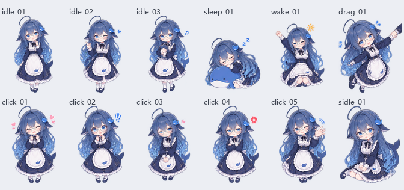

**V3 · 最新素材（`pet_v3r`，128 帧）— ① 待机 10 / 睡觉 8 / 睡醒 7 / 拖拽 6 / 点击 23（54 帧）**

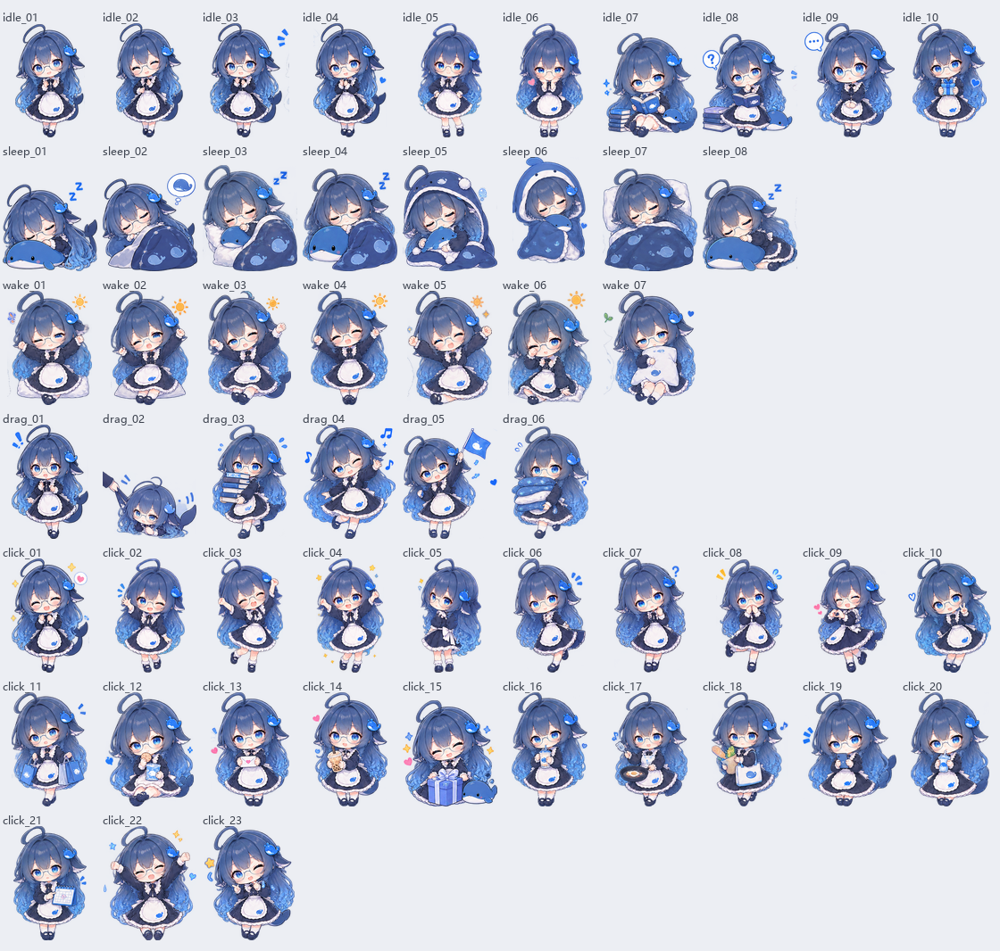

**V3 — ② 特殊待机 55 / 摸摸头 19（74 帧）**

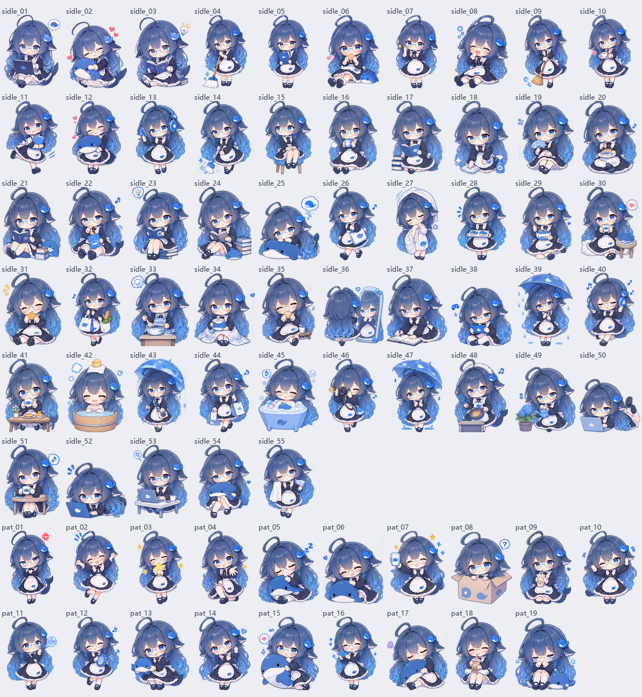

> 生成方式：`python -B tools/gen_lib_sheet.py <库名> [--cols=N] [--scenes=a,b] [--flow]`

---

## 三、功能详解

### 3.1 用量页（WorkBuddy / DSH）

- **指标区（主次分层）**：左侧**合计 Token** 主指标（超大数字 + 量级 + 环比 chip + 近 30 天迷你趋势线），右侧三行紧凑小指标（缓存命中 / 输入输出 / 会话请求）。
- **今日概况条**：请求 / 输入 / 输出 / 会话 / 缓存命中率。
- **模型明细表**：按 Token 总量降序，含占比条、缓存命中率、请求数；DSH 页表头为「调用」。
- **每日用量分布**：按日按模型堆叠柱，**整根柱统一渐变**（暗色向白渐隐 / 浅色同色淡出），支持**鼠标锚点滚轮缩放 + 拖动平移**（每次刷新回到默认视图，不记忆上次的缩放/平移）。
- **活跃热力图**：GitHub 风格，按日着色，支持**拖动平移 / 滚轮**翻看更早月份。
- **时间区间**：`今日` / `7天` / `30天` / `全部`（设置页与商汤页隐藏该切换）。

### 3.2 设置页（v9.4 新增，第95/97轮重做）

四组卡片，控件全部走**真·分段控件**（与顶栏区间条同源：`seg_box_qss` 外框 + `role="seg"` 药丸）：

| 卡片 | 内容 |
|---|---|
| **外观** | 深色模式、窗口材质四选一（默认 / 毛玻璃 / 液态 / 静态，**再点一次已选中即取消回默认**）、液态玻璃透明度三档、毛玻璃底纹（选择图片 / 恢复默认） |
| **窗口与启动** | 窗口尺寸双档（标准 990×610 / 舒适 1180×730）、开机自启动、窗口置顶 |
| **桌宠** | 显示开关 + 四套素材主题 2×2 网格（`v4` / `v3` / `v2` / `v1`） |
| **关于** | 版本号、一键重启、立即刷新 |

设置页顶栏左上角显示「设置」标题，右上角最小 / 关闭按钮原位保留；所有开关**即时生效并落盘**，重启后恢复。

### 3.3 商汤额度页

- **两张积分池卡**：通用积分池（蓝）、Flash-Lite 专属积分池（橙），各显示**周周期额度**与 **5h 窗口额度**（剩余 / 总额 + 百分比 + 重置时间）。
- **活动固定积分卡**：总量余额 + 最近一次到期时间与到期额度。
- **积分卡常驻**：数据或凭证尚未就绪时，卡片仍固定显示，数值取**官方公测期默认满额**；底部状态提示行此时才会出现，数据到齐后自动隐藏。
- **同步面板**：账号密码（用于凭证过期自动重登）+ 手动 cURL 两段式，支持就地保存 / 清除。

### 3.4 多机合并页

单列纵向三段：

1. **数据源管理** —— 本机机器框（点名字即可就地改名）+ 「导出本机数据」「导入 / 更新别机数据」。
2. **按机统计** —— 每台机器一行**双栏卡片**（中间以细竖线分隔）：
   - **左栏**（沿用原有呈现）：名次徽标、机器名（本机带蓝点）、Token 总量、用量占比条（**相对最大机器**归一）、请求数与数据区间；
   - **右栏**：**环形占比圈** —— 弧长表示该机占**全部机器总量**的真实百分比，圆心写百分比数字；
   - **口径切换**：面板头右侧的 **今日 / 总量** 分段按钮可整列重新排名。
3. **已导入的机器** —— 别机快照列表（来源徽标、导入时间），每行可 **覆盖更新** 或 **删除**。

**导入语义（一个按钮覆盖两种情形）：**

| 情形 | 行为 |
|---|---|
| 包内机器名**从未出现过** | 作为**一台新机器**加入统计 |
| 包内机器名**已存在** | 视为同一台机器的新快照，**覆盖其旧数据**（不是累加） |

导入**绝不影响本机数据**，也不影响其他机器的快照。存在别机数据时，WorkBuddy / DSH 页也会把别机数据一并计入（副标题标注「含 N 台别机」）。

### 3.5 桌宠形态

双击悬浮球或右键菜单「打开面板」进入统计面板；右键菜单可在四个素材主题间切换：

| 主题键 | 名称 | 素材目录 |
|---|---|---|
| `v1` | 经典素材（旧版） | `assets/pet` |
| `v2` | 新版素材（高清） | `assets/pet_v2` |
| `v3` | 最新素材（与原版合并） | `assets/pet_v3r` |
| `v4` | deepseek娘V4Pro | `assets/pet_v4` |
| `v5` | 鲸鱼少女 V5 | `assets/pet_v5` |

**V3 素材（`pet_v3r`）共七组动画**，透明背景高清 PNG：

| 动画键 | 帧数 | 触发 |
|---|---|---|
| `idle` 待机 | 10 | 默认常态 |
| `sidle` 特殊待机 | 55 | 待机较久后随机 |
| `sleep` 睡觉 | 8 | 待机超过 60s 入睡 |
| `wake` 醒来 | 7 | 睡眠结束 |
| `drag` 拖拽 | 6 | 按住拖动 |
| `click` 点击互动 | 23 | 单击身体下部 |
| `pat` 摸摸头 | 19 | 单击顶部 1/3 |

**V5 素材（`pet_v5`，蓝发鲸鱼少女）**：2026-10-26 并入浅浅猫勾选的 140 帧后共 **149 帧**
—— idle15 / click33 / sleep22 / wake15 / drag6 / **sidle48** / **pat10**
（后两个是这次新建的场景，之前 V5 只有基本动作）。全库帧高统一 360px（播放不跳动）。

点击分区按**角色实际绘制区**（`_pet_draw_rect`）的 1/3 划分：**顶部 1/3 为摸摸头，底部 2/3 为点击互动**。

**完整动作帧组（`seq/`）**：某个场景可以不止一张定格帧，而是一套逐帧动画。目录约定 `<主题>/seq/<场景>/<组名>/NN.png`（可选 `seq.json` 指定 `ms` 节拍与 `chance` 出场概率），运行时随机挑一组顺序循环；目前 `pet_v3r/seq/sleep/A/` 是 8 帧睡觉动画（`chance=0.5`，即一半概率播动画、一半概率从单帧库随机取一张定格）。**给其它单张动作补完整帧 = 往 `seq/<场景>/` 丢个目录，不用改代码。**

**自由调整大小**：右键菜单「📐 调整大小…」→ 桌宠四周出现内部透明的虚线框，拖动四角即可缩放（对角锚定，范围 72×90 ~ 460×575，框底实时显示当前 `宽 × 高`）；框右上角 **✓ 确认 / ✕ 取消**（`Enter` / `Esc` 同义）。确认后的尺寸记入 `ball_pos.json` 的 `w/h`，重启、切主题、切形态都不丢。

> `PET_ANIMS` 常量中另有 `special` 一项，是 V2 旧素材「摸摸头库」的目录名（`pet_v2/special/`）；V3 起该职能由 `pat` 目录承担，`special` 仅作为旧素材的加载回退名保留。

### 3.6 交互与主题

- **双尺寸**：标准模式 `990×610` / 舒适大窗口 `1180×730`，字重与行高分别标定，不做粗暴放大。
- **三档玻璃通透度**：`晶透水滴（高通透）` / `标准液态（推荐）` / `柔和微透（防眩光）`。
- **深浅色**：全程序统一调色板，切换后所有自绘控件同步刷新（含设置页内文字）。
- **材质三态互斥**：液态玻璃 / 毛玻璃（含静态底纹）/ 默认，再点一次已选中即回默认；两种材质**直切**不会掉回默认。
- **最小化到任务栏**（非托盘）：托盘图标仍可单击显示 / 收起面板。
- **单一实例**：重复启动不会起第二个常驻实例。
- **一键重启 / 开机自启**：见 §7。

---

## 四、技术架构

### 4.1 分层与模块职责

| 层 | 文件 | 职责 |
|---|---|---|
| 数据采集 | `scanner.py` | 遍历 `~/.workbuddy/projects/**/*.jsonl`，解析 `providerData.usage`；按 **mtime+size 增量**（`cache.json`），聚合落 `stats.json`。纯标准库 |
| 数据采集 | `card_app.load_dsh_stats()` | 读取 DSH 账本并聚合。⚠️ **不返回 `models`**（需现算）——统计 DSH 用量必须走 `peer_store.normalize_source()` |
| 数据合并 | `peer_store.py` | 多机快照的导出 / 导入 / 覆盖 / 合并；`merge_machines()`（跨来源总览）与 `source_view()`（**单来源**合并）。纯标准库 |
| 商汤数据 | `card_app` 商汤段 + `sn_login.py` / `sn_autologin_fetch.py` | 本地估算 + 控制台接口同步；JWT 解析与提前续期；cURL 零指纹字段探测 |
| 界面 | `card_app.py` | 全部 UI（卡片 / 悬浮球 / 桌宠 / 弹窗 / 图表）、主题系统、线程与缓存调度 |
| 启动 | `launcher.py` | 轻量启动器（不含 PySide6，8~10MB exe）：定位项目目录与 `pythonw.exe`，`DETACHED + CREATE_NO_WINDOW` 拉起主程序后立即退出 |
| 回归 | `test_switch_race.py` | offscreen 回归测试，**当前 524 项断言**，需全绿 |

### 4.2 数据流

```
WorkBuddy jsonl ──► scanner.scan_full() ──┐
                                          ├─► CardWindow.refresh()（后台线程）
DSH 账本 ─────────► load_dsh_stats() ─────┤        │
                                          │        ▼
商汤控制台接口 ───► sn_autosync_fetch() ──┘   _on_scan_done(src, stats)
                                                      │
                    peer_store.merge_machines() ◄─────┤（多机快照参与合并）
                    peer_store.source_view()    ◄─────┤
                                                      ▼
                                        按来源缓存（如 `_sn_cache`）→ render()
```

关键约定：

- **切页与渲染解耦**：`_apply_page()` 只做 `setCurrentIndex` / 可见性；`render()` 由数据回调触发。
- **迟到结果丢弃**：长任务带代次/序号，看门狗超时后旧线程的返回不会覆盖新状态。
- **首帧骨架**：多机页首帧画**同高骨架行**而非空态文案，避免数据到位后整列"唰一下长出来"。
- **本机不落快照**：本机永远实时扫描；导出的只是一次性副本。

### 4.3 关键实现要点

- **自定义来源用量回退**：自定义 provider 只落 `providerData.rawUsage`（OpenAI snake_case）、折算后的 `usage` 全 0 —— 扫描器在 usage 缺失或全 0 时按多候选容器名（`rawUsage` / `raw_usage` / `usageRaw` / `raw` / …）回退解析；`_norm_model()` 归一化 `custom-local:` 前缀，避免同一模型被拆成两组。
- **平滑曲线用单调三次插值（PCHIP）**：Catmull-Rom 在骤升骤降数据上会**过冲**，堆叠面积上下边界互相穿越导致填充错乱；PCHIP 保证不过冲、带子永不自交（与 ECharts/D3 `curveMonotoneX` 同源）。
- **堆叠上色用覆盖法**：PySide6 的 `QPainterPath.subtracted()` 实测**布尔运算失效**（差集 bbox 仍等于原区域），故改为"从最上层往最下层画完整区域、后画覆盖先画"。
- **置顶用 Win32 `SetWindowPos`**：Qt 的 `setWindowFlags()` 在 Windows 上会**销毁并重建原生窗口**（表现为整窗闪一下）；`SetWindowPos` 只改 Z 序。⚠️ ctypes 调 Win32 **必须给传句柄的函数设 `argtypes`**，否则 64 位下 HWND 被按 32 位截断、调用静默失败。
- **毛玻璃双层窗口**：`paint_pod()` 是材质挂载的唯一出口（`GlassPodFrame` / `GlassDialog` 两处），`role="section"` 毛玻璃下退化为顶部细线、`role="panel"` 保持实体。
- **打包资源解析**：未打包时 `APP_DIR` = 脚本目录；已打包时优先取 **exe 同级 `assets/`**，否则回退到包内（`sys._MEIPASS`）。
- **spawn 子进程前剥离 `_PYI_*` 环境变量**：PyInstaller onefile 的子进程引导器会校验「父进程可执行文件是否与自己一致」，`exe → launcher → pythonw` 一路继承后会误判并拒启。
- **商汤事件缓存**：`sn_events_cache.json` 按 `size+mtime` 失效，把商汤页刷新从 ~14.4s 降到 ~0.16s。

---

## 五、数据与文件格式

### 5.1 落盘位置

全部运行期数据位于 `~/.workbuddy/plugins/data/token-usage-stats/`（**不在仓库内**）：

| 文件 | 内容 |
|---|---|
| `cache.json` | 扫描增量游标（文件 mtime + size） |
| `stats.json` | WorkBuddy 聚合结果（每日 / 每模型明细） |
| `settings.json` | 界面与主题设置（见 §5.2） |
| `machine.json` | 本机机器名（可改名） |
| `sn_autosync.json` | 商汤同步配置（cURL / 账号）与最后已知值 |
| `sn_token.json` | 商汤 JWT 与解析出的过期时间 |
| `sn_cred.log` | 商汤凭据链路轻量日志（走了哪条路 / 耗时 / 成败） |
| `sn_events_cache.json` | 商汤事件磁盘缓存 |
| `peers/index.json` | 别机注册表 |
| `peers/<机器名>.json` | 各别机快照（文件名经安全化处理） |

### 5.2 `settings.json`

实际落盘的就是内存里的 `theme_state`：

```json
{
  "dark": false,
  "glass": false,
  "frost": false,
  "frost_static": false,
  "source": "wb",
  "pet": false,
  "pet_theme": "v3",
  "window_size": "default",
  "glass_transparency": "balanced",
  "always_top": true
}
```

> ⚠️ 一次性迁移的**标记位必须写进这个结构**，否则 `save_settings()` 一落盘就丢，迁移会每次启动重跑（曾把用户新选的主题反复改回旧值）。

### 5.3 导出包格式（`token-stats.peer/1`）

```json
{
  "format": "token-stats.peer/1",
  "version": 1,
  "app": "Token 审计卡片",
  "exported_at": "2026-09-19T03:30:00",
  "machine": "example-machine",
  "sources": {
    "wb":  { "...scanner.scan_full() 完整返回..." },
    "dsh": { "...load_dsh_stats() 完整返回..." }
  }
}
```

改动 `FORMAT_ID` 或字段名时，务必同步更新回归测试 fixture 与本文档。

### 5.4 商汤额度口径

| 项 | 值 |
|---|---|
| 5h 窗口 | 以 0 点为起点的**固定 5 小时分块**（00–05、05–10、10–15、15–20、20–24） |
| 池 5h 上限 | `60,000` |
| 池周上限 | `600,000`（7 天滚动周，内部锚点 `2026-08-28`） |
| 凭证类型 | JWT（RS256），寿命 **3 小时**；剩余 < 120s 直接提前续期 |
| 自动刷新 | 每 **5 分钟**（`SN_AUTOSYNC_TTL = 300`）；点 ⟳ 可强制绕过 |
| 凭据域名 | 必须是 `sensenova.cn`，否则视为无效 |
| 界面口径 | 大数字 = 本周余额；进度条/左侧数字 = 5h「剩余 / 总额」；百分比 = 剩余占比 |

> 「已用」是按本地 WB / DSH 调用次数估算的（非官方口径），页面页脚与 tooltip 已标注。

---

## 六、环境要求与安装

- **操作系统**：Windows（PySide6 可行于其他平台，但启动脚本仅提供 Windows 批处理）
- **Python**：3.13（本项目使用托管运行时，无需自行安装）
- **虚拟环境**：`~/.workbuddy/binaries/python/envs/pyside6`，已含 **PySide6 6.11.1**
- **依赖安装**：**无需 `pip install`**，venv 已就绪
- **素材**：`assets/` 随仓库提供（含四套桌宠素材与图标）

---

## 七、启动与使用

### 7.1 启动

双击以下任一启动器：

| 脚本 | 说明 |
|---|---|
| `start_card.bat` | 规范入口 |
| `启动统计悬浮球.bat` | 中文别名（内容相同） |
| `启动统计悬浮球.vbs` | **静默启动**，不弹控制台窗口（日常推荐） |
| `TokenStats.exe` | 打包产物，双击即用（图标正式，便于放桌面） |

启动后：出现悬浮球 → **单击**弹出卡片；标题栏可拖动；`–` 最小化到任务栏、`✕` 隐藏（不退出，托盘图标常驻）。

### 7.2 常用脚本

| 脚本 | 作用 |
|---|---|
| `enable_autostart.bat` | 在「开始菜单 → 启动」创建快捷方式，开机自启 |
| `桌面图标指向exe.bat` | 在桌面创建指向 exe 的快捷方式 |
| `商汤自动登录.bat` | 单独跑一次商汤登录（获取 / 刷新凭证） |
| `重新打包exe.bat` | 重新打包主程序 exe |
| `推送到GitHub.bat` | GitHub 首次授权 + 推送（见 §12） |

---

## 八、商汤积分自动同步配置

商汤官方**未提供积分查询 API**，本工具通过抓取官网控制台接口实现自动同步：

1. 浏览器打开商汤控制台「积分额度」页；
2. 按 **F12** → **Network（网络）**；
3. 刷新页面，找到响应中含积分数字的请求（如 `tokenplan/pool-usage`）；
4. 在该请求上 **右键 → Copy → Copy as cURL**；
5. 回到工具「商汤额度」页的 **商汤同步** 面板，粘贴 cURL，点击 **保存并测试**；
6. 字段由程序**零指纹结构探测**自动识别，**无需手动填写任何数字**。

可选：在「账号密码」分支填入商汤账号密码，凭证过期时程序会自动重登（仅存本机）。

> - 凭证（JWT）约 **3 小时**过期；过期且无账号密码时，余额回退到**本地估算**并提示重新抓包。
> - 程序每 **5 分钟**自动刷新；切页也会按频控刷新，点 `⟳` 立即强制刷新。

---

## 九、打包与发布

```bash
# 主程序单文件 exe（产物：<构建目录>/dist/TokenStats.exe，并复制一份到桌面）
python tools/build_exe.py
python tools/build_exe.py --onedir     # 目录模式：体积更大但启动更快

# 轻量启动器（不含 PySide6，8~10MB）
python tools/build_launcher.py

# 生成应用图标（assets/app_icon.ico / .png）
python tools/make_app_icon.py
```

打包约定：

- **只打包"在用"的素材**：`assets/pet`、`pet_v2`、`pet_v3r`、`pet_v4` 与 `app_icon`。
  备份 / 实验目录（如 `pet_alt`、`pet_v3_add`、`pet_v5*`、`*_bak_*`）**不进包**，否则体积白白翻几倍。
- 图标单一来源 `assets/app_icon.ico`：exe 图标、任务栏、托盘三处统一。
- 构建临时目录优先放 **D 盘**（经 `TMP`/`TEMP` 传给 PyInstaller 子进程），避免塞满 C 盘。

---

## 十、开发与调试

### 10.1 常用命令

```bash
# 运行主程序（pyside6 venv 的 pythonw，无控制台窗口）
~/.workbuddy/binaries/python/envs/pyside6/Scripts/pythonw.exe card_app.py

# 单独调试扫描引擎（输出聚合摘要）
~/.workbuddy/binaries/python/envs/pyside6/Scripts/python.exe scanner.py --force

# 全量语法检查（内存编译，不写 .pyc）
~/.workbuddy/binaries/python/envs/pyside6/Scripts/python.exe tools/syntax_check.py

# 回归测试（必须在 offscreen 下运行）
QT_QPA_PLATFORM=offscreen \
  ~/.workbuddy/binaries/python/envs/pyside6/Scripts/python.exe test_switch_race.py

# 重新生成 README 的界面预览图（隔离 HOME + 合成匿名数据 + 真实渲染链路）
~/.workbuddy/binaries/python/envs/pyside6/Scripts/python.exe tools/shot_readme.py
```

`tools/` 脚本：

| 脚本 | 作用 |
|---|---|
| `syntax_check.py` | 全项目语法检查（内存编译，不落 `.pyc`） |
| `restart_app.py` | 重启卡片应用（改动生效） |
| `shot_readme.py` | 生成 README 预览图（隔离数据 + 合成匿名数据） |
| `shot_settings.py` | 真实渲染设置页四态截图 |
| `demo_chart_v2.py` | 每日用量分布三套画法的同源可切换 demo |
| `check_material_btn.py` | 设置页材质按钮回归（含连续切换路径） |
| `check_settings97.py` / `check_settings97b.py` | 设置页交互 / 卡片唯一 / 浅色适配 |
| `check_topmost97.py` | 置顶开关不重显窗口（判据：`winId()` 不变） |
| `check_ball_drag.py` | 悬浮球拖动（桌宠开 / 关两种形态） |
| `check_custom_source97.py` | 自定义来源用量回退 + 模型名归一化 |
| `set_frost_bg.py` | 用任意图片重新生成毛玻璃静态底纹 |
| `shot_pet_sheet.py` | 生成桌宠素材拼图 |
| `metrics_regression.py` | 素材指标回归 |
| `build_exe.py` / `build_launcher.py` / `make_app_icon.py` | 打包与图标 |

### 10.2 回归测试覆盖

切页 race 防护、同步数学、cURL 解析（bash / cmd）、指纹与零指纹探测、真实接口 fixture、单列渲染、窗口位置统一、代理 10061 直连重试、多机数据源（导出 / 导入 / 合并 / 覆盖 / 命名）、导入语义（新增 vs 覆盖）、视觉基座（按钮工厂 / 自绘弹窗 / 导航自绘 / 主题联动 / 排行条）、暗色输入框、内联改名、骨架占位行、商汤页池卡常驻与占位满额、按机统计双栏（环形占比口径 / 今日·总量切换 / `metric` 命名守门）、毛玻璃模式（材质互斥三态 / 纹理连续性 / 开关落盘）、底纹真高斯（均匀图不产生暗边 / 衰减曲线不是线性斜坡）、按钮材质分档（三档样式互异）、每日分布不再记忆缩放视图、按钮选中态底图取色（含左栏「来源」导航）、材质直切、副本去重（按消息去重，不丢文件）、三右键菜单材质同步、DSH 同源同模型合并、设置页（区间条不泄漏 / 局部刷新不重建控件 / 浅色字色跟随 / 卡片唯一）、置顶开关不重建窗口、自定义来源用量回退、桌宠自由缩放（虚线框几何 / 四角锚定拖拽 / 上下限钳制 / ✓✕ 与 Enter·Esc / 落盘与取消还原 / 悬浮球不冲桌宠尺寸 / 切主题自动取消）、睡觉动作帧组与单帧按 chance 混播、V5 主题（鲸鱼少女）素材与画布统一 —— **524 项断言，需全过**。

> 测试开头备份、结尾还原用户真实配置；商汤 / settings / peers 全部隔离到临时目录，**不得写入真实数据目录**。

### 10.3 offscreen 截图 / 渲染技巧（踩坑记录）

1. Qt 找不到系统字体 → 手工 `QFontDatabase.addApplicationFont()` 注册 `C:\Windows\Fonts\msyh.ttc` 等，否则中文全是豆腐块。
2. `render()` 里旧控件走 `deleteLater()`，而 `processEvents()` **默认不处理 DeferredDelete** → 旧控件从布局摘除后仍是子控件、留在原位继续绘制，会画成「表头与首行重叠」的假象。截图前需 `QCoreApplication.sendPostedEvents(None, QEvent.DeferredDelete)`。
3. 图表（`StackedBarChart`）每次 `set_data` 都会复位到默认视图，截图无需再手动复位。
4. `widget.grab()` 对透明窗口**保留 alpha**，可直接叠到自选背板上；若发现角落被合成成实色，先查 alpha 是否被覆盖。
5. **毛玻璃截图必须抓真实屏幕**（`grabWindow(0)`）：DWM 材质 offscreen 没有，且毛玻璃模式下控件透明，控件自绘抓图会变成白底。
6. ⚠️ **不要用 Qt 虚函数名做实例属性名。** `QWidget` 继承自 `QPaintDevice`，而 `QPaintDevice::metric()` 是虚函数 —— PySide6 会把它当"Python 覆写"去取 `self.metric` 调用。一旦写成 `self.metric = "total"`（字符串），构造 `QPainter(self)` 时就会抛 `Error calling Python override of QWidget::metric(): 'str' object is not callable`，并且**进程直接 abort（不是可捕获的普通异常）**。同类危险名字：`event` / `sizeHint` / `paintEvent` / `metric`。
7. ⚠️ **Python 覆写里抛异常 = 硬崩溃。** 排查手法：把被覆写的方法用 `try/except` 包一层并打印 traceback；`faulthandler` 只会打出**当前 Python 栈**，若崩在纯 C++ 路径，栈里不会出现我们的帧 —— 这时优先怀疑"某个被覆写方法抛了异常"。

### 10.4 语法检查与杀软误报

本项目的开发环境装有国产杀软，会把 `__pycache__/*.pyc` **误判为木马并连带结束进程**，典型症状为「命令退出码为 0 但无任何输出」或进程意外退出。因此：

- 语法检查一律走 `tools/syntax_check.py`（内存 `compile()`，不落 `.pyc`），**不要用 `python -m py_compile`**；
- 任何 `import card_app` 的脚本开头加 `sys.dont_write_bytecode = True`，或命令行加 `-B`；
- 根治办法是把项目目录加入杀软信任区。

---

## 十一、代码规范与视觉系统

### 11.1 提交与版本

- 提交信息格式：`第N轮：<一句话说明>`；**定点 `git add`**，不要 `add -A`。
- 每轮先更新根目录 [`协作进度.md`](协作进度.md)（演进历程 + 协作者备注），提交紧随其后。
- 版本标识：`card_app.py` 内 `APP_BUILD`（当前 `v9.4-frost`）。

### 11.2 按钮：统一工厂 + 材质分档

所有按钮经 `make_btn(kind, text)` 创建、`style_btn(btn, ...)` 重刷；外观由
`material_btn_qss(role, dark, glass, frost)` 按**材质分档**生成：

| role | 用途 | 外观 |
|---|---|---|
| `primary` | 面板主操作（导出 / 保存 / 删除确认） | 实心蓝底白字，hover 加深 |
| `ghost` | 次要操作（改名 / 覆盖更新） | 透明底 + 描边，hover 转蓝 |
| `danger` | 破坏性操作（删除） | 同 ghost，hover 转红 |
| `icon` | 标题栏轻量开关 | 无边框，仅 hover 底色 |
| `seg` | 分段控件项 | 未选中透明；选中 = **底图取色**的实色药丸 |
| `pick` | 网格候选（桌宠主题） | 选中只换描边 / 淡底 / 文字色，不做实心块 |
| `opt` | 操作胶囊（选择图片 / 恢复默认） | 独立描边胶囊 |
| `mat` | 侧栏材质按钮 | 按材质三档互异 |

改主题或字号后**必须重刷样式**，否则颜色不跟随。

### 11.3 弹窗与浮层：一律自绘

- `GlassDialog` 基类必须是**真 `QDialog`** —— 用 `QFrame` + 手写事件循环"假装"模态会导致 `isModal()=False`、`sizeHint` 算不出、**弹窗根本看不见**。
- 自绘控件颜色取**全局调色板**，不要缓存到实例属性（主题切换后会拿到旧色）。

---

## 十二、GitHub 协作与跨机同步

- 远程 <https://github.com/Suqianqiana/token-stats>，分支 `main`。
- **只在 main 上协作、禁 rebase/amend 已推送提交**（commit hash 是跨机同源基准）。
- 推送通道：git 自带 `store` 凭据助手（`~/.git-credentials`，明文、在家目录、不进仓库）。
- 仓库设有仓库级 `http.proxy`（指向本机 Clash）——代理没在跑时推送必然失败，绕开直连也常不通；推不上去时**提交留在本地**即可，不要反复硬试。
- `git ls-remote origin` 成功 ≠ 凭据有效（仓库 public，匿名就能读）；验证凭据必须靠**需要写权限的操作**。
- **先核同源再合并**：`git -C <peer> rev-parse <已知提交>` 比 hash；本机独有 0 个才能 `--ff-only`。
- `_archive/` 与运行期数据**都不随 git 走**。

---

## 十三、目录结构

```
token-stats/
├── card_app.py            # 主程序（全部 UI + 主题 + 调度）
├── scanner.py             # WorkBuddy 用量扫描引擎（纯标准库）
├── peer_store.py          # 多机快照导出 / 导入 / 合并
├── sn_login.py            # 商汤登录与凭证管理
├── sn_autologin_fetch.py  # 商汤控制台抓取
├── launcher.py            # 轻量启动器
├── test_switch_race.py    # offscreen 回归（524 项断言）
├── tools/                 # 语法检查 / 打包 / 截图 / 专项回归
├── assets/                # 桌宠素材、图标、毛玻璃底纹
├── docs/                  # 设计稿、协作进度、界面预览图
└── 协作进度.md             # 逐轮演进记录
```

---

## 十四、已知限制与注意事项

1. **商汤「已用」是本地估算**，非官方口径；积分池上限为公测期观察值，官方调整后需同步改常量。
2. **DSH 计费展示已下线**（本地估算口径与官方不一致），但 `load_dsh_stats()` 的 `totalCost` / `daily.cost` 字段保留 —— `peer_store` 多机合并与导出格式在用，删了会破坏跨机格式。
3. **自定义来源的 usage 依赖回退解析**：若 WorkBuddy 将来改为完全不留 `rawUsage`，则这部分用量仍会缺失（当前已覆盖 `rawUsage` / `raw_usage` / `usageRaw` / `raw` / `rawResponse` 等容器名）。
4. **PySide6 的 `QPainterPath.subtracted()` 布尔运算不可用**（实测确认），堆叠图一律用覆盖法；后续若升级 PySide6 可复测。
5. **截图脚本会短暂显示窗口**（毛玻璃需真实屏幕抓取），且运行前必须清掉其它 card_app 实例（单实例互杀会让扫描线程死掉、界面停在"正在扫描"）。
6. **合成数据最后一天必须是"真实今天"**，否则界面默认的「今日」口径全为 0。
7. **Windows venv 的 `pythonw.exe` 是重定向 stub** → 1 个逻辑实例 = 2 个进程（用 `ExecutablePath` 判别）。
8. **执行环境无 tty/GUI**：Git Credential Manager 弹不出登录窗；托管 Python 严禁进交互 REPL；系统级工具（`netstat` / `reg` / `sc` / `wmic`）被安全策略禁用。
9. **部分杀软会查杀 `__pycache__/*.pyc`**（误报为木马并结束进程），典型症状为「命令退出码为 0 但无任何输出」或进程意外退出 —— 处置办法见 §10.4。

---

<sub>构建 `v9.4-frost` · 回归 482 项全绿 · 详见 [`协作进度.md`](协作进度.md)</sub>
